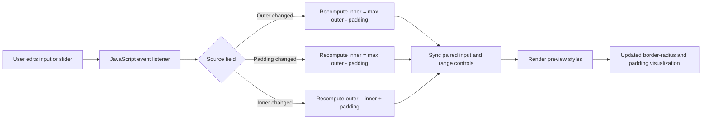

# Nested Radius Calculator

A zero-build, browser-native utility for calculating visually correct nested corner radii from `outer radius`, `padding`, and `inner radius` inputs.

[](https://github.com/OstinUA/Nested-Radius-Calculator)
[](https://github.com/OstinUA/Nested-Radius-Calculator)
[](LICENSE)
[](https://github.com/OstinUA/Nested-Radius-Calculator)

**Live Demo:** [Open the calculator in your browser](https://ostinua.github.io/Nested-Radius-Calculator/)


> [!IMPORTANT]
> This repository is a static UI utility, not a packaged runtime library. The documentation below reflects the actual codebase structure and behavior present in this repository.

## Table of Contents

- [Title and Description](#nested-radius-calculator)
- [Features](#features)
- [Tech Stack & Architecture](#tech-stack--architecture)
  - [Core Technologies](#core-technologies)
  - [Project Structure](#project-structure)
  - [Key Design Decisions](#key-design-decisions)
- [Getting Started](#getting-started)
  - [Prerequisites](#prerequisites)
  - [Installation](#installation)
- [Testing](#testing)
- [Deployment](#deployment)
- [Usage](#usage)
- [Configuration](#configuration)
- [License](#license)
- [Contacts & Community Support](#contacts--community-support)

## Features

- Real-time nested border-radius calculation using the relationship `inner + padding = outer`.
- Bidirectional synchronization across all three parameters:
  - editing `outer radius` recalculates `inner radius`
  - editing `padding` recalculates `inner radius`
  - editing `inner radius` recalculates `outer radius`
- Immediate visual preview of concentric rounded rectangles to validate geometry before shipping CSS.
- Dual input modalities for each dimension:
  - numeric text input for precise values
  - range sliders for fast exploratory tuning
- Built-in guardrail logic that clamps computed values to non-negative results.
- Zero-build architecture with no bundler, package manager, or runtime dependency installation required.
- Multilingual interface support driven by an in-repo translation dictionary.
- Responsive, single-page layout suitable for desktop and tablet browser workflows.
- GitHub Pages-friendly hosting model for frictionless publishing and sharing.

> [!NOTE]
> The calculator operates on pixel values in the UI, but the underlying radius relationship is generic and can be adapted to other unit systems if you modify the client-side script.

## Tech Stack & Architecture

### Core Technologies

- `HTML5` for the application shell, semantic structure, and control wiring.
- `CSS3` for layout, component styling, responsive behavior, and preview visualization.
- `Vanilla JavaScript (ES6+)` for state synchronization, rendering, and localization updates.
- `Google Fonts` (`Inter`) for typography.
- `GitHub Pages` as the natural deployment target for the static site.

### Project Structure

```text
Nested-Radius-Calculator/
├── .github/
│   └── FUNDING.yml              # Funding links used by GitHub
├── LICENSE                      # Apache 2.0 license text
├── README.md                    # Project documentation
├── img_nested-radius-calculator.PNG
│                               # README preview asset
├── index.html                   # Single-page app markup and control layout
├── process_pr.py                # Repository utility script
├── script.js                    # Radius calculation, event handlers, and rendering logic
├── style.css                    # Theme, spacing, responsive layout, and preview styling
└── translations.js              # Translation dictionary and language switch handler
```

### Key Design Decisions

#### 1. Static-first architecture
The project intentionally avoids a build pipeline. That decision keeps onboarding trivial, reduces maintenance overhead, and makes the tool easy to host on any static file server.

#### 2. DOM-centric state management
Rather than introducing a framework or external state container, the implementation reads directly from DOM inputs and writes back to the DOM after each interaction. For a small, deterministic calculator, this keeps the execution model obvious and easy to debug.

#### 3. Formula-driven synchronization
The core interaction model is built around a simple invariant:

```text
innerRadius = max(outerRadius - padding, 0)
outerRadius = innerRadius + padding
```

This ensures the preview remains logically coherent regardless of which control the user edits.

#### 4. Dictionary-based localization
Translations are stored in a plain JavaScript object and applied to nodes marked with `data-i18n`. This is lightweight, framework-agnostic, and sufficient for a compact interface.

#### 5. Preview as the primary feedback loop
The rendered nested boxes visually confirm the numerical calculation. This is especially useful for UI engineers and designers validating perceptual corner balance rather than relying on raw numbers alone.

### Interaction Flow



> [!TIP]
> If you plan to extend the project, keep the current formula logic isolated in `script.js` so alternate unit systems, presets, or export formats can be added without changing the core HTML structure.

## Getting Started

### Prerequisites

You only need a modern browser to use the calculator locally.

Recommended tooling:

- `Google Chrome`, `Mozilla Firefox`, `Safari`, or `Microsoft Edge`
- `Git` for cloning the repository
- `Python 3` or any simple HTTP server if you prefer serving the files instead of opening `index.html` directly

> [!NOTE]
> The project does not require `npm`, `pnpm`, `yarn`, Docker, or a JavaScript bundler.

### Installation

Clone the repository and run it locally using one of the following approaches.

#### Option 1: Open the static entry point directly

```bash
git clone https://github.com/OstinUA/Nested-Radius-Calculator.git
cd Nested-Radius-Calculator
```

Open `index.html` in your browser:

```bash
# Linux
xdg-open index.html

# macOS
open index.html

# Windows PowerShell
start index.html
```

#### Option 2: Serve the project over a local HTTP server

```bash
git clone https://github.com/OstinUA/Nested-Radius-Calculator.git
cd Nested-Radius-Calculator
python3 -m http.server 8080
```

Then visit:

```text
http://localhost:8080
```

> [!IMPORTANT]
> Serving the site over HTTP is the safest option if you later add assets, API mocks, or browser features that behave differently under `file://` URLs.

## Testing

This repository currently does **not** include an automated test suite, linter configuration, or CI-driven browser tests. Validation is therefore manual unless you add tooling.

### Current validation workflow

Run a local server:

```bash
python3 -m http.server 8080
```

Then verify the following behaviors in the browser:

1. Changing `Outer Radius` updates `Inner Radius` as `max(outer - padding, 0)`.
2. Changing `Padding` updates `Inner Radius` with the same non-negative clamp.
3. Changing `Inner Radius` updates `Outer Radius` as `inner + padding`.
4. Range sliders and number inputs remain synchronized for all three values.
5. The preview boxes update instantly to reflect new radius and padding values.
6. Switching languages updates all `data-i18n` labels and footer text.
7. Responsive layout remains usable below `768px` viewport width.

### Recommended commands if you add quality gates

If you choose to introduce automated checks, these are sensible starting points for a static frontend project:

```bash
# HTML validation example
npx html-validate index.html

# CSS linting example
npx stylelint "*.css"

# JavaScript linting example
npx eslint script.js translations.js
```

> [!WARNING]
> The commands above are recommendations only. They are not wired into the repository today and will fail until the corresponding toolchain is added.

## Deployment

The project is well suited for static hosting platforms.

### GitHub Pages

Because the application consists entirely of static assets, GitHub Pages is the most natural deployment path.

#### Suggested workflow

1. Push the repository to GitHub.
2. Ensure the default branch contains `index.html` at the publish root.
3. Enable **Settings → Pages** in the GitHub repository.
4. Select the branch and folder to publish.
5. Confirm the generated site URL.

### Generic static hosting

You can also deploy the repository to any static platform, including:

- GitHub Pages
- Netlify
- Vercel static hosting
- Cloudflare Pages
- Amazon S3 + CloudFront
- Internal Nginx or Apache static hosting

### Production deployment checklist

- Keep `index.html`, `style.css`, `script.js`, and `translations.js` in the same relative paths.
- Verify that the Google Fonts stylesheet is reachable in your deployment environment.
- Confirm the preview image path if you mirror the README externally.
- Set appropriate caching rules for static assets if hosting behind a CDN.
- Optionally version the site with tagged releases for reproducible documentation links.

### Containerization guidance

The repository does not currently ship with a `Dockerfile` or `docker-compose.yml`. If containerization is required, a minimal Nginx-based image is sufficient because no server-side runtime is needed.

```Dockerfile
FROM nginx:alpine
COPY . /usr/share/nginx/html
```

> [!CAUTION]
> If you containerize the project, exclude `.git` and non-runtime helper files where appropriate to keep the image small and avoid leaking repository metadata.

## Usage

The calculator is designed for designers and frontend engineers who need consistent nested corners in cards, panels, dialogs, or inset surfaces.

### Basic workflow

1. Set the parent container radius in `Outer Radius`.
2. Set the space between parent and child in `Padding`.
3. Read the computed `Inner Radius`.
4. Copy the resulting values into your CSS.

### Example calculation

If your outer container has a `40px` radius and `10px` padding:

```text
innerRadius = max(40 - 10, 0) = 30
```

That maps to CSS like this:

```css
.card {
  border-radius: 40px;
  padding: 10px;
}

.card__inner {
  border-radius: 30px;
}
```

### Browser-side initialization flow

```html
<!-- Minimal HTML shell -->
<link rel="stylesheet" href="style.css">
<script src="translations.js"></script>
<script src="script.js"></script>
```

```js
// The application bootstraps itself on DOMContentLoaded.
// It initializes the default language and seeds the first calculation.
document.addEventListener('DOMContentLoaded', () => {
  setLanguage('en');
  updateFromOuter(40);
});
```

### Practical UI example

```text
Outer Radius: 24px
Padding:      8px
Inner Radius: 16px
```

This is useful for:

- cards with inset content wrappers
- modal shells with padded inner panels
- dashboard widgets with nested surfaces
- design system tokens for rounded containers

> [!TIP]
> When translating design tokens from Figma or another design tool, start from the outer radius and padding first. That generally produces the most stable inner value for implementation.

## Configuration

This project is intentionally low-configuration.

### Environment variables

There is currently **no** `.env` file and no runtime environment variable contract.

### Startup flags

There are currently **no** CLI flags or boot-time parameters.

### Configuration surfaces that do exist

#### 1. `translations.js`
Use this file to customize or extend the available languages.

Current language keys:

- `en`
- `ru`
- `ua`
- `hi`
- `es`
- `ar`
- `fr`
- `pt`
- `de`
- `id`

Translation shape:

```js
const translations = {
  en: {
    title: "Corner Radius Calculator",
    label_outer: "Outer Radius",
    label_padding: "Padding",
    label_inner: "Inner Radius",
    pill_outer: "Outer",
    pill_padding: "Padding",
    pill_inner: "Inner",
    footer: "Open Source project on GitHub | Made for designers"
  }
};
```

#### 2. `script.js`
Use this file to change calculation rules, default values, event behavior, or rendering logic.

Current operational rules:

```text
When outer changes:  inner = max(outer - padding, 0)
When padding changes: inner = max(outer - padding, 0)
When inner changes:  outer = inner + padding
```

#### 3. `style.css`
Use this file to configure theme tokens, spacing, layout breakpoints, and preview appearance.

Example tunables include:

- CSS custom properties in `:root`
- component spacing and sizing
- responsive breakpoint behavior
- preview colors and border treatments

#### 4. `index.html`
Use this file to modify form layout, copy, available controls, or initial slider bounds.

### Configuration caveats

> [!NOTE]
> Input ranges are currently hard-coded in the HTML:
> - `Outer Radius`: `0` to `200`
> - `Padding`: `0` to `100`
> - `Inner Radius`: `0` to `200`
>
> If you need larger values, update both the numeric expectations in `script.js` and the corresponding `<input type="range">` attributes in `index.html`.

## License

This project is licensed under the `Apache-2.0` license. See [`LICENSE`](LICENSE) for the complete terms and redistribution conditions.

## Contacts & Community Support

## Support the Project

[](https://www.patreon.com/OstinFCT)
[](https://ko-fi.com/fctostin)
[](https://boosty.to/ostinfct)
[](https://www.youtube.com/@FCT-Ostin)
[](https://t.me/FCTostin)

If you find this tool useful, consider leaving a star on GitHub or supporting the author directly.
