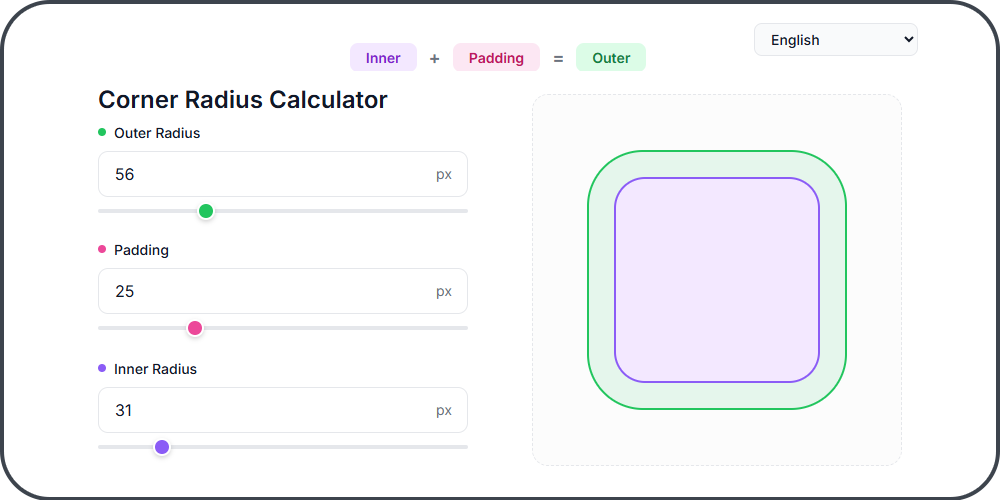
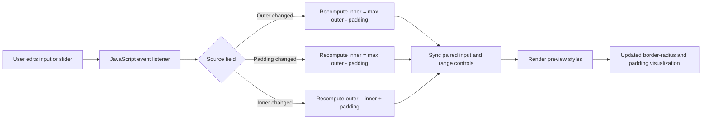

# Nested Radius Calculator

A zero-build, browser-native utility for calculating visually correct nested corner radii from `outer radius`, `padding`, and `inner radius` inputs.

[](https://github.com/OstinUA/Nested-Radius-Calculator)
[](https://github.com/OstinUA/Nested-Radius-Calculator)
[](LICENSE)
[](https://github.com/OstinUA/Nested-Radius-Calculator)

**Live Demo:** [Open the calculator in your browser](https://ostinua.github.io/Nested-Radius-Calculator/)



> [!IMPORTANT]
> This repository is a static UI utility, not a packaged runtime library. The documentation below reflects the actual codebase structure and behavior present in this repository.

## Table of Contents

- [Title and Description](#nested-radius-calculator)
- [Features](#features)
- [Tech Stack & Architecture](#tech-stack--architecture)
  - [Core Technologies](#core-technologies)
  - [Project Structure](#project-structure)
  - [Key Design Decisions](#key-design-decisions)
- [Getting Started](#getting-started)
  - [Prerequisites](#prerequisites)
  - [Installation](#installation)
- [Testing](#testing)
- [Deployment](#deployment)
- [Usage](#usage)
- [Configuration](#configuration)
- [License](#license)
- [Contacts & Community Support](#contacts--community-support)

## Features

- Real-time nested border-radius calculation using the relationship `inner + padding = outer`.
- Bidirectional synchronization across all three parameters:
  - editing `outer radius` recalculates `inner radius`
  - editing `padding` recalculates `inner radius`
  - editing `inner radius` recalculates `outer radius`
- Immediate visual preview of concentric rounded rectangles to validate geometry before shipping CSS.
- Dual input modalities for each dimension:
  - numeric text input for precise values
  - range sliders for fast exploratory tuning
- Built-in guardrail logic that clamps computed values to non-negative results.
- Zero-build architecture with no bundler, package manager, or runtime dependency installation required.
- Multilingual interface support driven by a modular ISO locale registry with per-language files.
- Responsive, single-page layout suitable for desktop and tablet browser workflows.
- GitHub Pages-friendly hosting model for frictionless publishing and sharing.

> [!NOTE]
> The calculator operates on pixel values in the UI, but the underlying radius relationship is generic and can be adapted to other unit systems if you modify the client-side script.

## Tech Stack & Architecture

### Core Technologies

- `HTML5` for the application shell, semantic structure, and control wiring.
- `CSS3` for layout, component styling, responsive behavior, and preview visualization.
- `Vanilla JavaScript (ES6+)` for state synchronization, rendering, and localization updates.
- `Google Fonts` (`Inter`) for typography.
- `GitHub Pages` as the natural deployment target for the static site.

### Project Structure

```text
Nested-Radius-Calculator/
├── .github/
│   ├── workflows/               # CI: lint, SAST, Scorecard, automation
│   └── FUNDING.yml              # Funding links used by GitHub
├── i18n/
│   ├── index.mjs                # Locale registry, resolution, and key guard
│   └── locales/                 # One ISO-locale dictionary per language
├── tools/
│   └── requirements.txt         # Pinned automation dependencies
├── index.html                   # Page markup and control layout
├── radius.mjs                   # Geometry rules and input normalisation (DOM-free)
├── script.js                    # UI controller: state, events, rendering
├── style.css                    # Design tokens, layout, and preview styling
├── process_pr.py                # PR → issue documentation automation
├── trigger action/
│   └── trigger_action.py        # Label-driven triage issue automation
├── LICENSE                      # Apache 2.0 license text
└── README.md                    # Project documentation
```

### Key Design Decisions

#### 1. Static-first architecture
The project intentionally avoids a build pipeline. That decision keeps onboarding trivial, reduces maintenance overhead, and makes the tool easy to host on any static file server.

#### 2. Unidirectional state flow
The controller in `script.js` owns a single frozen snapshot of the three values. Each control is bound to one intent handler (`outer`, `padding`, or `inner`); the handler recomputes the remaining two values, then writes the snapshot to both the number field and the slider of every parameter. Nothing is ever read back out of the DOM, so the two controls for one parameter cannot drift apart and there are no listener feedback loops. The DOM is treated strictly as a rendering target.

#### 3. Formula-driven synchronization
The core interaction model is built around a simple invariant:

```text
innerRadius = max(outerRadius - padding, 0)
outerRadius = innerRadius + padding
```

This ensures the preview remains logically coherent regardless of which control the user edits.

#### 4. Modular file-based localization
Translations are stored in dedicated locale modules under `i18n/locales/` and applied to nodes marked with `data-i18n`. A central registry validates that every locale exposes the exact same keys before the UI initializes, preventing missing-string runtime errors while keeping the system lightweight and framework-agnostic.

#### 5. Preview as the primary feedback loop
The rendered nested boxes visually confirm the numerical calculation. This is especially useful for UI engineers and designers validating perceptual corner balance rather than relying on raw numbers alone.

### Interaction Flow



> [!TIP]
> The radius rules live in `radius.mjs`, which has no DOM or browser dependencies. Extending the tool with alternate units, presets, or export formats therefore starts from a module that can be unit-tested on its own, without touching the markup or the controller.

## Getting Started

### Prerequisites

You only need a modern browser to use the calculator locally.

Recommended tooling:

- `Google Chrome`, `Mozilla Firefox`, `Safari`, or `Microsoft Edge`
- `Git` for cloning the repository
- `Python 3` or any simple HTTP server if you prefer serving the files instead of opening `index.html` directly

> [!NOTE]
> The project does not require `npm`, `pnpm`, `yarn`, Docker, or a JavaScript bundler.

### Installation

Clone the repository and run it locally using one of the following approaches.

#### Option 1: Open the static entry point directly

```bash
git clone https://github.com/OstinUA/Nested-Radius-Calculator.git
cd Nested-Radius-Calculator
```

Open `index.html` in your browser:

```bash
# Linux
xdg-open index.html

# macOS
open index.html

# Windows PowerShell
start index.html
```

#### Option 2: Serve the project over a local HTTP server

```bash
git clone https://github.com/OstinUA/Nested-Radius-Calculator.git
cd Nested-Radius-Calculator
python3 -m http.server 8080
```

Then visit:

```text
http://localhost:8080
```

> [!IMPORTANT]
> Serving the site over HTTP is the safest option if you later add assets, API mocks, or browser features that behave differently under `file://` URLs.

## Testing

The repository does not ship a bundled test runner; the calculator is small enough that its behaviour is specified by the geometry module and verified manually in the browser. CI still gates every pull request with the static checks below.

### Current validation workflow

Run a local server:

```bash
python3 -m http.server 8080
```

Then verify the following behaviors in the browser:

1. Changing `Outer Radius` updates `Inner Radius` as `max(outer - padding, 0)`.
2. Changing `Padding` updates `Inner Radius` with the same non-negative clamp.
3. Changing `Inner Radius` updates `Outer Radius` as `inner + padding`.
4. Range sliders and number inputs remain synchronized for all three values.
5. The preview boxes update instantly to reflect new radius and padding values.
6. Switching languages updates all `data-i18n` labels, the document title, and footer text across every supported locale.
7. Responsive layout remains usable below `768px` viewport width.

### Automated checks

`.github/workflows/lint.yml` runs on every pull request and validates that the change set is sound without installing any project dependencies:

```bash
# Syntax-check every shipped module
shopt -s globstar
for file in script.js radius.mjs i18n/**/*.mjs; do node --check "$file"; done

# Parse all dictionaries and assert their keys match the reference locale
node --input-type=module -e "import('./i18n/index.mjs');"

# Compile the automation scripts
python3 -m compileall -q process_pr.py "trigger action"
```

The same workflow, plus CodeQL analysis, OpenSSF Scorecard, and Dependabot maintenance, is defined under `.github/workflows/`.

## Deployment

The project is well suited for static hosting platforms.

### GitHub Pages

Because the application consists entirely of static assets, GitHub Pages is the most natural deployment path.

#### Suggested workflow

1. Push the repository to GitHub.
2. Ensure the default branch contains `index.html` at the publish root.
3. Enable **Settings → Pages** in the GitHub repository.
4. Select the branch and folder to publish.
5. Confirm the generated site URL.

### Generic static hosting

You can also deploy the repository to any static platform, including:

- GitHub Pages
- Netlify
- Vercel static hosting
- Cloudflare Pages
- Amazon S3 + CloudFront
- Internal Nginx or Apache static hosting

### Production deployment checklist

- Keep `index.html`, `style.css`, `script.js`, and the `i18n/` directory in their current relative paths.
- Verify that the Google Fonts stylesheet is reachable in your deployment environment.
- Confirm the preview image path if you mirror the README externally.
- Set appropriate caching rules for static assets if hosting behind a CDN.
- Optionally version the site with tagged releases for reproducible documentation links.

### Containerization guidance

The repository does not currently ship with a `Dockerfile` or `docker-compose.yml`. If containerization is required, a minimal Nginx-based image is sufficient because no server-side runtime is needed.

```Dockerfile
FROM nginx:alpine
COPY . /usr/share/nginx/html
```

> [!CAUTION]
> If you containerize the project, exclude `.git` and non-runtime helper files where appropriate to keep the image small and avoid leaking repository metadata.

## Usage

The calculator is designed for designers and frontend engineers who need consistent nested corners in cards, panels, dialogs, or inset surfaces.

### Basic workflow

1. Set the parent container radius in `Outer Radius`.
2. Set the space between parent and child in `Padding`.
3. Read the computed `Inner Radius`.
4. Copy the resulting values into your CSS.

### Example calculation

If your outer container has a `40px` radius and `10px` padding:

```text
innerRadius = max(40 - 10, 0) = 30
```

That maps to CSS like this:

```css
.card {
  border-radius: 40px;
  padding: 10px;
}

.card__inner {
  border-radius: 30px;
}
```

### Browser-side initialization flow

```html
<link rel="stylesheet" href="style.css">
<script type="module" src="script.js"></script>
```

```js
// script.js is a module, so it runs after the document is parsed and
// bootstraps itself: it registers the locale options, applies the preferred
// language, seeds the initial state, and performs the first render.
```

### Practical UI example

```text
Outer Radius: 24px
Padding:      8px
Inner Radius: 16px
```

This is useful for:

- cards with inset content wrappers
- modal shells with padded inner panels
- dashboard widgets with nested surfaces
- design system tokens for rounded containers

> [!TIP]
> When translating design tokens from Figma or another design tool, start from the outer radius and padding first. That generally produces the most stable inner value for implementation.

## Configuration

This project is intentionally low-configuration.

### Environment variables

There is currently **no** `.env` file and no runtime environment variable contract.

### Startup flags

There are currently **no** CLI flags or boot-time parameters.

### Configuration surfaces that do exist

#### 1. `i18n/`

`i18n/index.mjs` holds the locale registry; each dictionary lives in `i18n/locales/` as a single default export. The registry drives the language picker, the lookup table, and the startup validation, so adding a language is one import plus one entry.

Current locales:

`en`, `zh`, `es`, `fr`, `pt`, `ru`, `ja`, `de`, `uk`, `pl`, `nl`, `kk`, `sv`, `cs`

Dictionary shape:

```js
export default {
  title: "Corner Radius Calculator",
  label_outer: "Outer Radius",
  label_padding: "Padding",
  label_inner: "Inner Radius",
  pill_outer: "Outer",
  pill_padding: "Padding",
  pill_inner: "Inner",
  footer: "Open Source project on GitHub | Made for designers"
};
```

`data-i18n` attributes in `index.html` reference these keys. Every dictionary must expose exactly the same key set as `en`; a missing, unexpected, or blank entry aborts initialisation with an error naming the locale and the offending keys.

#### 2. `script.js`
Use this file to change calculation rules, default values, event behavior, or rendering logic.

Current operational rules:

```text
When outer changes:  inner = max(outer - padding, 0)
When padding changes: inner = max(outer - padding, 0)
When inner changes:  outer = inner + padding
```

The picker preselects the first supported browser language (`pt-BR` resolves to `pt`), falling back to `en`, and remembers an explicit choice in `localStorage` when storage is available.

#### 3. `style.css`
Use this file to configure theme tokens, spacing, layout breakpoints, and preview appearance.

Example tunables include:

- CSS custom properties in `:root`
- component spacing and sizing
- responsive breakpoint behavior
- preview colors and border treatments

#### 4. `index.html`
Use this file to modify form layout, copy, available controls, or initial slider bounds.

### Configuration caveats

> [!NOTE]
> The sliders expose a comfortable editing range, while the numeric fields accept any value inside the calculator's domain:
> - sliders: `Outer Radius` `0`–`200`, `Padding` `0`–`100`, `Inner Radius` `0`–`200`
> - numeric fields: `0`–`1000`, rounded to whole pixels
>
> The domain and the normalisation rule live in `radius.mjs` (`RADIUS_LIMIT`, `toRadiusPixels`). Widen the slider attributes in `index.html` and the limit in that module together.

## License

This project is licensed under the `Apache-2.0` license. See [`LICENSE`](LICENSE) for the complete terms and redistribution conditions.

## Contacts & Community Support

## Support the Project

[](https://www.patreon.com/OstinFCT)
[](https://ko-fi.com/fctostin)
[](https://boosty.to/ostinfct)
[](https://www.youtube.com/@FCT-Ostin)
[](https://t.me/FCTostin)

If you find this tool useful, consider leaving a star on GitHub or supporting the author directly.
